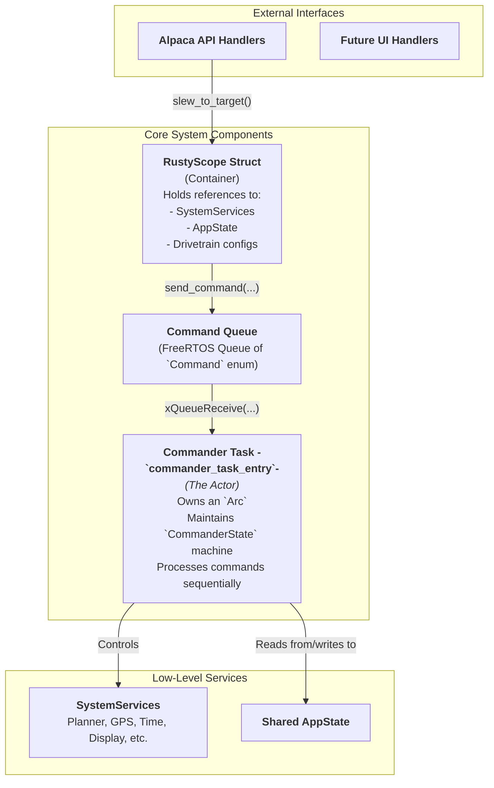

# The RustyScope Controller (`mount/rustyscope.rs`)

The `RustyScope` struct and its associated `commander_task` represent the top-level application logic for the entire telescope mount. This module is the central hub that integrates all other system components—such as services, drivers, and data models—into a cohesive, functioning whole. It is responsible for orchestrating high-level actions and maintaining the overall state of the telescope.

## 1. Core Responsibilities

*   **System Integration:** To aggregate all necessary system services (`SystemServices`) and state (`AppState`) into a single, logical controller object.
*   **Command Processing:** To provide a single, serialized point of execution for all mount commands (`slew`, `track`, `park`, etc.) via the `commander_task`.
*   **State Management:** To be the primary actor that reads from and writes to the `Shared AppState`, ensuring it accurately reflects the mount's condition.
*   **High-Level Action Implementation:** To contain the `execute_*` methods which implement the top-level business logic for actions like `SlewToTarget`, `PulseGuide`, and `Sync`.

## 2. Architecture: The Central Controller and its "Actor" Task

The `RustyScope` component follows a powerful and robust architectural pattern. The `RustyScope` struct itself is a container for dependencies, while the `commander_task` acts as a dedicated "Actor" or "Command Processor" that works on its behalf.

### Key Components:

1.  **`RustyScope` Struct:**
    *   This struct does not run code itself; it's a data container. It is created once in `main()` and shared via an `Arc` (Atomic Reference Counter).
    *   It holds a reference to `SystemServices`, giving it access to all hardware and software services.
    *   It holds a reference to the `Shared AppState`, allowing it to read and modify the mount's state.
    *   It owns the configuration for the mount's physical properties (`ra_drivetrain`, `dec_drivetrain`).
    *   It holds the handle to the `command_queue`, providing the `send_command` method.

2.  **`Command` Enum (`commands.rs`):**
    *   This defines the "language" of the control system. It is a list of all possible high-level actions (e.g., `SlewToTarget`, `PulseGuide`, `Park`).
    *   API handlers translate user requests into these `Command` variants.

3.  **`CommandQueue`:**
    *   A standard FreeRTOS queue that decouples the command issuers (the API) from the command executor (the `commander_task`).
    *   This is the key to the system's non-blocking, asynchronous nature. An API handler can push a `SlewToTarget` command onto the queue and return an "OK" response to the client in milliseconds, long before the slew itself has even started.

4.  **`commander_task_entry` (The Commander Task):**
    *   This is a dedicated FreeRTOS task that runs in a continuous loop. It is the **only** part of the system that executes complex, multi-step actions.
    *   **The Loop:**
        1.  **Poll Queue:** It performs a non-blocking check on the `CommandQueue` for a new command.
        2.  **State Machine:** It executes logic based on its internal `CommanderState` (e.g., `Idle`, `WaitingForSlew`, `WaitingForPark`).
        3.  **Execute:** If in the `Idle` state and a new command is present, it calls the appropriate `scope.execute_*` method to begin an action and transitions its own state (e.g., to `WaitingForSlew`).
        4.  **Monitor:** If in a `WaitingFor...` state, it polls the `MotionPlanner` (`is_slewing()`) to check for completion. When the action is finished, it performs any final steps (like starting tracking) and transitions its state back to `Idle`.
        5.  **Telemetry:** On every loop, it calls `execute_update_telemetry` to keep the `Shared AppState`'s coordinates and status fresh.

## 3. Data Flow Example: The `Park` Command

1.  **API Call:** An Alpaca client sends a `PUT /api/v1/telescope/0/park`.
2.  **Handler (`put.rs`):** The API handler calls `scope.command_park()`.
3.  **`command_park()` (`rustyscope.rs`):** This method creates a `Command::Park` enum and pushes it onto the `CommandQueue`. The API call returns immediately.
4.  **Commander Dequeue:** The `commander_task`, in its `Idle` state, dequeues the `Command::Park`.
5.  **Pre-computation:** It sees that `Park` is a finite move, so it first calls `execute_stop_tracking()` to gracefully stop any current motion.
6.  **Execution:** It then calls `scope.execute_park()`.
7.  **`execute_park()` (`rustyscope.rs`):** This method calculates the absolute step position for parking and calls `planner.move_to_steps()`.
8.  **State Transition:** The `commander_task` sees that `execute_park()` succeeded and transitions its own state from `Idle` to `CommanderState::WaitingForPark`.
9.  **Monitoring:** On subsequent loops, the commander sees its state is `WaitingForPark`. It repeatedly checks `planner.is_slewing()`.
10. **Completion:** When the planner finishes the move, `is_slewing()` returns `false`. The commander detects this, sets the `is_parked` and `at_park` flags in the `Shared AppState` to `true`, and transitions its own state back to `CommanderState::Idle`, ready for a new command (like `Unpark`).

## 4. Key Design Decisions

*   **Actor Model:** The Commander Task acts as a classic "Actor," processing messages from a mailbox (the queue). This serializes all major commands, preventing race conditions and ensuring deterministic behavior.
*   **Stateful Commander:** The commander is not just a simple command dispatcher; it is a stateful entity. Its internal `CommanderState` machine is what allows it to manage complex, multi-stage operations that take time to complete.
*   **Separation of `command_*` and `execute_*`:** The public API of `RustyScope` consists of simple, non-blocking `command_*` methods that just enqueue a message. The complex, potentially blocking logic is contained within private `execute_*` methods that are only ever called by the single, serialized commander task. This is a crucial separation of concerns for a concurrent system.
*   **Centralized Telemetry:** By having the commander task be responsible for the periodic `execute_update_telemetry` call, the system guarantees that the official "state of the mount" is always kept up-to-date by the same authority that is commanding its motion.
## 5. Conclusion
The `commander_task` is the heart of the application's control logic. By acting as a stateful, serialized command processor, it brings order to the concurrent nature of the system. It is the only task that executes complex, multi-step physical actions, and it is the only task designed to block while waiting for those actions to complete. This actor-based design is the key to preventing race conditions and ensuring the rest of the system, particularly the network API, remains responsive and non-blocking at all times.
