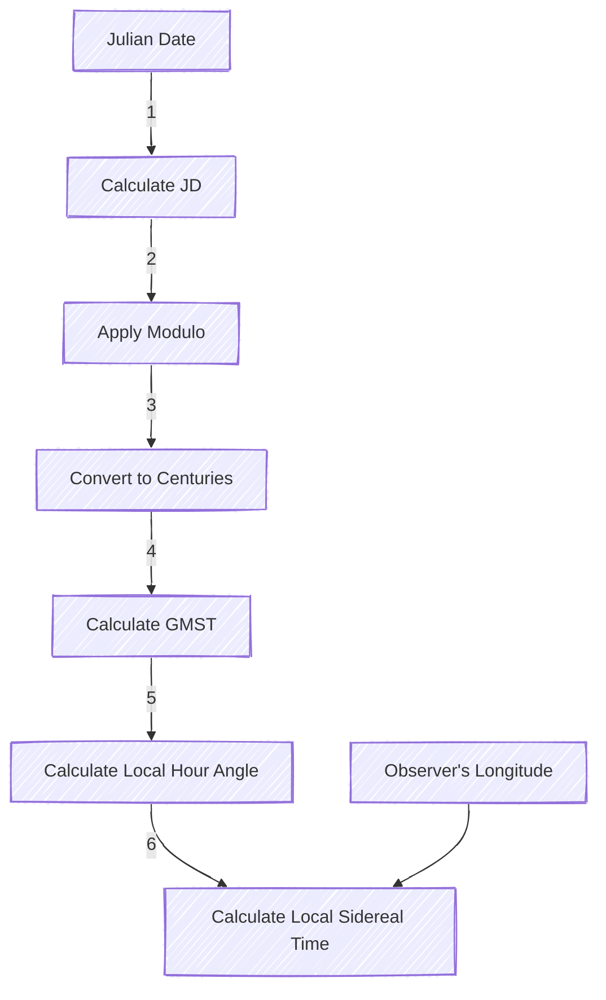

# Chapter 2 - Implementation

> ⚠️ **Warning:** Do not push the big red button.

> 📝 **Note:** Sunrises are beautiful.

> 💡 **Tip:** Remember to appreciate the little things in life.  

> 🦀🔭 Rusty-Scope  🪐 - planets 

> ☢️ - Radioactive

> 🧭 - compass  🦙 - llama

\\( \int x dx = \frac{x^2}{2} + C \\)

\\( currentRA = \frac{currentRA + 12}{24} \\)

\begin{equation}
x+1\over\sqrt{1-x^2}
\end{equation}


### Sidereal Time

Detailed Calculations:

1. Julian Date Calculation:
   $$JD = 2440587.5 + \text{day fraction}$$
   $$JD = 2440587.5 + (\text{day} - 12 \times \lfloor\frac{\text{day}}{12}\rfloor)$$

2. Apply Modulo:
   $$JD \bmod 0.99999726$$

3. Convert to centuries since J2000:
   $$T = \frac{JD - 2451545}{36525}$$

4. Greenwich Mean Sidereal Time (GMST) Calculation:

   4.1. Calculate θ:
   $$ 
   \theta = \text{modulo}(2\pi \times (0.7790572732640 + 1.00273781191135448 \times du), 2\pi) 
   $$

   4.2. Calculate T:
   $$ 
   T = \frac{JD_{TT} - 2451545.0}{36525.0} 
   $$

   4.3. Calculate the polynomial P(T):
   $$ 
   P(T) = 0.014506 + 4612.156534T + 1.3915817T^2 
   $$
   $$
   \quad - 0.00000044T^3 - 0.000029956T^4 - 0.0000000368T^5 
   $$

   4.4. Calculate GMST Prime (GMSTP):
   $$ 
   GMSTP = \text{modulo}\left(\frac{P(T)}{3600}, 360\right) 
   $$

   4.5. Finally, calculate GMST:
   $$ 
   GMST = \text{modulo}(\theta + GMSTP, 23.9344699) 
   $$

5. Local Sidereal Time:
   $$LST = \text{modulo}(GMST + \text{longitude}/15, 23.9344699)$$

6. Local Sidereal Time:
   $$LST = GMST + LHA - 180$$

```rust
// see https://thecynster.home.blog/2019/11/04/calculating-sidereal-time/
pub fn compute_sidereal_time(longitude: f64) -> f64 {
    const JD2000: f64 = 2451545.0;
    
    let now = Epoch::now().unwrap();
    //println!("now: {}", now);
    let jd_utc = now.to_jde_utc_days();
    //println!("jd_utc: {}", jd_utc);
    let jd_tt = now.to_jde_tt_days();
    //println!("jd_tt: {}", jd_tt);

   let du = jd_utc - JD2000;
   //println!("du: {}", du);

   let theta = rad_to_hours(modulo(
       TAU * (0.7790572732640 + 1.00273781191135448 * du),
       TAU,
   ));
   //println!("theta: {}", theta);

   let poly = poly![
        0.014506,
        4612.156534,
        1.3915817,
        -0.00000044,
        -0.000029956,
        -0.0000000368,
    ];

    let t = (jd_tt - JD2000) / 36525.0; // years

    let gmstp = deg_to_hours(modulo(poly.eval(t).unwrap() / 3600.0, 360.0));
    //println!("gmstp: {}", gmstp);

    let greenwich_sidereal_time = modulo(theta + gmstp, 23.9344699);
    // println!("greenwich_sidereal_time: {}", greenwich_sidereal_time);
    
    let lst = modulo(greenwich_sidereal_time + deg_to_hours(longitude), 23.9344699);
    // println!("lst: {}", lst);
    // let reciprical_lst = lst - 11.96722;
    // println!("reciprical_lst: {}", reciprical_lst);
    lst

}
```

```mermaid
---
config:
  layout: elk
  elk:
    mergeEdges: true
    nodePlacementStrategy: LINEAR_SEGMENTS
---
flowchart LR
  A[GetSystemTime] --> B[JDutc]
  A[GetSystemTime] --> C[JDtt]
  B --> D[du] --> F[theta]
  C --> E[t] --> G[poly]
  G[poly] --> H[gmstp]
